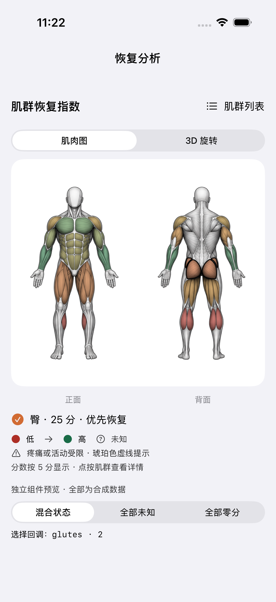
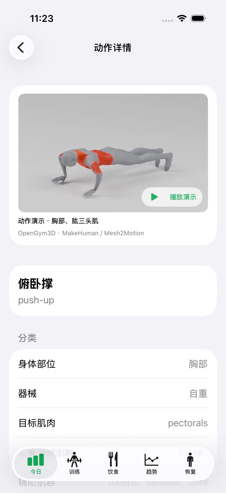

# 营养录入与动作／恢复展示

核查日期：2026-10-12。此版本在独立分支供评审；没有采购素材或发布到设备。

## 本次实现

- 食物记录、常用食物只输入碳水、蛋白质、脂肪，热量实时按 `4 × 碳水 + 4 × 蛋白质 + 9 × 脂肪` 计算，单位为克和 kcal。每份／每 100 克、总量修正、份量变化和固定餐继续使用同一计算链。
- 旧记录与已有食物的热量快照在未改宏量营养素时保留；修改宏量后使用新公式。不会批量改写历史。酒精、糖醇及纤维等可能导致计算值与包装标示不同；4/4/9 是日常记录的通用换算，不是所有食物的精确成分分析。参见 [FAO 能量换算方法](https://www.fao.org/4/Y5022E/y5022e04.htm)。
- 恢复页默认展示细致的正背面解剖插图，可点击 11 个肌群，按已有恢复分数着色；未知保持灰色，疼痛／活动受限有琥珀色虚线。保留原 3D 旋转和无障碍列表。这里改的是显示，不改变恢复分数算法。
- 动作详情接入离线循环播放、暂停、静态海报、后台暂停与资源失败回退。开启“减少动态效果”时默认不自动播放。只给普通俯卧撑 `0662` 配置样片，其他 1,323 个动作继续展示原有说明。

恢复图是可交互的二维插图，不是新建的三维解剖模型。俯卧撑样片用于确认播放交互与免费制作路线，画质尚未达到用户参考图一，不能视为完整动作素材库。

## 素材路线比较

| 方案 | 核实到的内容／价格 | 对本项目的意义 |
| --- | --- | --- |
| [Gym Visual](https://gymvisual.com/content/6-price-rules) | GIF 单个 US$3.6，10 个起 US$0.9/个；50 个约 US$45。视频 5 个起 US$6/个。 | 最接近参考图一的肌肉高亮风格；[条款](https://gymvisual.com/content/3-terms-and-conditions-of-use)允许购入素材用于 App，禁止转售／原始素材再分发。需先选清单和确认预算，不能将素材直接放进公开仓库。 |
| [MoveKit](https://movekit.com/pricing) | 单个 US$4.99；582 个完整包 US$299。 | 适合批量取得统一画风视频，但动作覆盖和目录映射仍需逐项核对。[许可说明](https://movekit.com/licensing)。 |
| [OpenGym3D](https://github.com/AssiamahS/opengym3d) + 本地渲染 | 部分素材标记 CC0，其他动作有不同来源限制。此次只选了许可明确的俯卧撑。 | 零采购费、离线可运行；每个动作仍需检查许可、动作质量、地面接触和镜头。不能把整个库当作同一种许可。 |
| 自建模型与动作 | [MakeHuman](https://static.makehumancommunity.org/about/license.html)人体与 [Mesh2Motion](https://github.com/Mesh2Motion/mesh2motion-app)艺术／动画素材可提供 CC0 起点。 | 身体模型可以复用，成本主要在每个动作的骨骼动画、器械配合、肌肉高亮和动作校验。一次建模不等于自动得到 1,324 个准确演示。 |

建议：先看本次免费样片。如果确认需要参考图一的画质，选择 30–50 个常用动作采购授权素材并逐项映射，比逐个自制同等质量动画更直接。本次没有购买、接入收费 API 或在运行时下载媒体。

恢复图使用 MIT 许可的 [js-rich-body-highlighter](https://github.com/crmapache/js-rich-body-highlighter)，固定来源版本，保留署名并转换为原生路径。详见[恢复资产来源](../Trainote/Resources/BodyMap/ANATOMY-PROVENANCE.md)、[动作样片来源](../Trainote/Resources/ExerciseMedia/EXERCISE-MEDIA-PROVENANCE.md)和[重现脚本](../ExerciseMediaPreview/README.md)。

## 验收记录

在 iPhone 17 / iOS 26.5 专用模拟器上分次执行并通过：287 项主工程单元测试、6 项功能 UI 测试、2 项人体预览 UI 测试。动作目录检查仍为 1,324 项，Swift 编译和 `git diff --check` 通过。

功能验收包括营养自动计算／保存／再次记录／固定餐份量，恢复页选择肌群／疼痛约束／大字号列表，以及动作视频播放、暂停、返回后查看无素材动作的文字说明。播放器启动时异步入队造成的误失败已复现并修复。资源缺失、坏视频、离页期间加载完成等边界由单元测试覆盖。

PR #14 修复复验：小肌群的触摸区域扩大至至少 44 点，重叠时选择距离原始肌肉路径最近的肌群，插图外观保持不变。CI 录像确认搜索文本已完整输入但测试读取了旧快照，现改为查询完整搜索值；食物编辑测试先将记录完整滚到浮动标签栏上方，再点击并等待编辑页。iPhone 17 Pro / iOS 26.4.1 上通过 290 项单元测试和 5 项相关 UI 回归，0 失败、0 跳过；结果包为 `/tmp/trainote-pr14-repair-targeted.xcresult`。完整 CI 另以 PR 当前提交的检查为准。

结果包（本机临时目录）：`/tmp/trainote-visual-targeted.xcresult`（五项饮食／恢复 UI 通过）、`/tmp/trainote-visual-retest.xcresult`（287 项单元通过）、`/tmp/trainote-exercise-ui-final.xcresult`（动作 UI 最终通过）、`/tmp/trainote-anatomy-visuals.xcresult`（两项预览 UI 通过）。前两次执行中的已修复失败保留在原结果包中，不能将它们当成整包绿色结果。

所有截图中的训练／营养数据均为测试数据，不是用户实际健康记录。下面的恢复彩色图来自独立组件的合成分数；[正式恢复页未知状态](visuals/2026-10-12/recovery-unknown.png)、[暗色预览](visuals/2026-10-12/recovery-dark.png)也保留供评审。

| 恢复肌肉图（合成状态） | 俯卧撑样片（正式动作详情） |
| --- | --- |
|  |  |

[直接查看三秒 MP4 样片](../Trainote/Resources/ExerciseMedia/push-up.mp4)。当前版本未在真机安装，完整 GitHub CI 以 PR 的实际状态为准。
