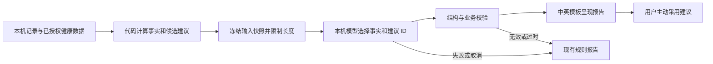

# 端侧报告与首次使用须知详细计划

状态：**计划中，技术与交互细节供审阅，尚未实施**。更新：2026-10-26（Europe/London）。

用户已确认：美区、简体中文与 English、免费、公开下载；先试内置 0.6B，效果不合适再评估 1B；首次打开显示隐私与使用须知，主动同意后进入 App。本轮细化方案，不下载模型、不修改产品代码、不操作付款或提交商店。首发全量验收标准继续留到后续。

## 1. 当前实现与本次目标

代码基线是 `main` / `origin/main` 的 `3167b11900c660e0306fb73a4afa88039b5153fd`；现有文档 PR 为 [#20](https://github.com/Jerryszz02/trainote/pull/20)，本轮在同一分支续写。此前 head `a48f1e4` 的 iOS CI 已通过，这是旧文档提交的构建/回归证据，不是端侧推理或新首启流程的验证。

| 当前代码事实 | 拟议改动 |
| --- | --- |
| `HealthReportIntegration` 装配 `proxy: nil`，当前只有规则报告 | 在设备内运行一个选定模型，失败仍显示规则报告 |
| `AIReportService` 的模型路径依赖远端 transport、发送同意与撤回流程 | 新增本机生成路径；保留已有云端协议，不伪装成远端服务 |
| `AppShell` 总是显示五 Tab；`healthOnboardingCompleted` 没有用于生产首启分流 | 在 AppShell 之前增加版本化须知入口 |
| 启动和回前台会恢复健康服务并刷新分析/报告 | 同意前阻止同步、新报告生成和模型装载；同意后才恢复正常任务 |
| 报告页进入、切换类型、刷新和回前台都会触发刷新 | 自动动作只刷新规则/有效缓存，点击“生成本机 AI 报告”才推理 |
| 报告校验固定远端 model/prompt，缓存键未区分端侧模型 | 明确报告来源、模型/量化/提示版本，避免误标和串用缓存 |

范围不变：模型只挑选、排序已有事实和允许的建议，最多三项观察、三项建议；数值计算、候选建议、适用性判断和实际写入仍由代码负责。不增加聊天、自由医疗建议、联网模型、账号、广告或遥测。

## 2. 开发者会员：还差哪一步

注册 Apple Account / 登录开发者网站，与加入付费 Apple Developer Program 是两个步骤。2026-10-26 看到的是注册入口；点击网页继续注册后出现通用错误，账号页转入登录页。**目前未核实付费会员、身份审核或付款状态**，不根据“注册好了”推定会员已生效。个人信息、账号标识和截图不写入仓库。

后续按账号页面的真实状态处理：

1. 使用同一个 Apple Account 打开 Apple Developer App 的 Account，查看 Enroll Now 或已有注册进度；也可在网页登录后查看 Account。
2. 若尚在注册，完成主体/联系资料与身份核验；个人和组织的路径不同。个人通常可在注册时确认协议并购买；组织通常先等 Apple 核实信息后发出后续步骤。
3. 在购买步骤核对年度价格和续费方式。官方基准为每年 99 USD，实际显示本地区币种/价格；App 内注册为自动续费年订阅。[会员与购买][A1]、[App 注册步骤][A2]
4. 以会员确认和账号中的有效会员状态为完成依据，之后才核实 Xcode 付费 Team、Bundle ID、签名与 App Store Connect 访问。若已经付款但 24 小时仍未收到会员确认，按 Apple 指引联系支持，不重复购买。

仅在美区分发不要求把注册身份、住址或付款地区改成美国；填写真实资料，应用销售地区在后续 App Store Connect 中选择。[应用地区设置][A4] 账号主体与最终健康功能的审核要求继续按[总计划](../app-store/us-launch-plan.md)核对。本机模型原型可先在开发环境验证，不必等待商店会员付款。

## 3. 模型和运行引擎

### 3.1 先 0.6B，再按原因决定是否尝试 1B

| 顺序 | 候选及用途 | 进入下一步的判断 |
| --- | --- | --- |
| 首选 | `Qwen/Qwen3-0.6B`，非思考模式，GGUF 量化版本 | 先检验结构输出、重点选择和真实设备开销 |
| 同模型对照 | 0.6B 的 Q4 与较高精度版本对照；官方 Q8_0 文件可作参考 | 排除量化过度、模板错误或输入设计导致的失败 |
| 质量不足的备选 | `google/gemma-3-1b-it`，文本模型，作为 1B 比较候选 | 用同一组数据比较，不能仅凭更大参数量认定更好 |
| 运行失败 | 保留当前本地规则报告 | 无法加载、超时、取消、内存/温度压力或无效输出时回退 |

Qwen 的官方资料提供非思考模式；应在实际推理引擎中验证对应 chat template 的映射，不把 Python 的 `enable_thinking=False` 当成可直接传给所有运行库的参数。[Qwen 模型卡][M1]

0.6B 的 4-bit 理论权重约 300 MB，1B 约 500 MB；这不是实际安装大小或峰值内存。官方 Qwen Q8_0 的约 639 MB 文件已在上一轮核对，本轮没有下载。Q4 需要记录实际来源/转换过程；优先从官方高精度权重转换，避免把 Q8 再量化造成的差异当成模型能力差异。

Gemma 3 有 1B 文本版本与多语言训练资料，但中文任务质量仍须实测；采用 Gemma 自有许可，官方 Hugging Face 下载入口要求接受条款。它目前只是备选，不能沿用 Qwen 的 Apache-2.0 声明，也不绕过下载访问条件。[Gemma 模型卡][M2]、[官方文件入口][M3]

“不行”的处理分开：选择质量差时尝试 1B；单纯耗时/内存差时先缩短输入、减少输出和调整量化/引擎。更大模型通常不会解决资源不足。Apple 系统端侧模型和 MLX 保留为后续备选，本轮不同时建设三套引擎。

### 3.2 建议以 llama.cpp 做第一轮验证

采用 `llama.cpp` 的 iOS XCFramework、Metal 后端和 Swift 包装，避免额外服务器。官方已有 iOS XCFramework 和语法约束支持；这只证明存在接入途径，不证明本项目 iOS 17 / 当前 Xcode 配置已经兼容。[iOS 集成][R1]、[语法约束][R2]

实施时先锁定经过验证的 release/commit、XCFramework 校验值与设备/Simulator slices；若预编译版本不兼容，再评估固定源码构建。保持当前最低 iOS 17，不能为了方便接入直接提高最低版本。每次只装配一个引擎、一个发布模型，避免同时打包 0.6B 和 1B。

权重放在受忽略的开发缓存或构建输入目录，不把数百 MB 文件直接提交 Git。仓库只跟踪来源、revision、量化配置、SHA-256、许可和准备脚本；最终模型作为 App 资源打包。发布构建缺少已选模型/校验不符时应明确失败，开发与自动化测试可显式使用规则或 mock 配置。首发不增加运行时模型下载服务。

## 4. 报告数据流与接入方式

### 4.1 输入与输出

- 输入继续使用 `ReportInput` 的事实、质量标记、缺失信息和代码批准的候选建议；不加入用户自由备注、姓名、完整健康样本或对话历史。把长本地 ID 映射成短别名，保留原始依赖关系在本机校验层。
- 初始试验配置为约 2,048 token 上下文、最多 256 输出 token、单并发；它们是待测起点，不是正式承诺。为模板和输出预留空间，候选建议及其依据不能随意截断；放不下时采用明确的汇总/裁剪策略或直接回退。
- 模型只返回类似 `{"factIDs":["f2","f5"],"actionIDs":["a1"]}` 的选择结果，允许空数组；这是拟议的新端侧格式，不是现有远端响应协议。语法约束限制键、ID 枚举和数量，Swift 再校验存在性、重复项、依据、质量标记及规则限制。
- 文案由代码构造并交给既有双语呈现层；模型不提供新数字、不编造事实或修改候选动作参数。结构合法仍可能选择不佳，必须单独评估内容相关性。
- 复用已有数据最小化、规则和呈现组件；不向端侧路径要求 App Attest、远端 consent lease 或伪造 `deepseek-flash` 身份。

### 4.2 服务、线程与缓存

- 新增本机 generator/runtime，复用 `ReportGenerating` 契约可复用的部分；将云端 transport 生命周期和本机开关明确分开。实际推理、tokenization 与权重加载离开 MainActor，UI 只接收状态和结果。
- 冻结输入指纹、模型 revision、量化、提示/格式版本；生成完成前再次核对记录版本、健康连接状态、须知版本和用户是否取消。旧结果不能覆盖新日期或新记录。
- 缓存键加入引擎/模型/量化/提示版本，明确区分规则、本机模型和云端历史。现有校验器只认可固定远端 model，需要增加对应本机策略，而非放宽成任意模型/任意文本均通过。
- 尽量不迁移 SwiftData 业务数据；如报告缓存格式改变，显式迁移兼容字段或仅清理可重建缓存，保留手动记录。历史来源按原值识别，不把旧云端报告重新标成本机生成。
- 取消、离开相关页面、转后台和断开健康连接时取消任务；取消完成后才释放推理上下文。严重温度状态或内存警告时停止生成并回退。不要依赖捕获系统强杀来解决内存超限。
- 首次模型加载仅由主动生成触发；首轮采用串行任务，完成/取消后释放上下文，是否保留短时权重缓存由真机数据决定。

### 4.3 用户可见行为

进入报告页先展示规则报告或匹配当前记录的有效缓存。点击“生成本机 AI 报告 / Generate on-device AI report”后显示加载、生成、取消状态；切换日期/报告类型和普通刷新不自动推理。成功显示来源；失败说明已展示规则结果，不无限自动重试。

本机 AI 使用由明确的生成动作触发，无须每次再弹同意窗口。接受须知后默认允许用户主动生成，不自动开始推理；设置中提供独立的“允许本机 AI 报告”开关，可关闭而继续使用记录和规则报告。关闭立即取消任务、释放资源，当前报告页改为规则结果，不再自动展示旧 AI 缓存；既有 AI 报告只在用户主动打开的历史页中只读查看，可单独删除。该偏好不能写成旧云端 `.aiReports` 同意，也不要求开启 AI 才能使用基础功能；已关闭的偏好不会因重新确认须知被重置。

## 5. 首次打开的须知

### 5.1 页面与文字

首启显示一个可滚动的完整页面，顶部可切换简体中文 / English，内容离线可读。主按钮为“同意并继续 / Agree and continue”，次按钮为“暂不同意 / Not now”；不预勾选、不要求倒计时、不把滚动到底当作已读证明。暂不同意就留在须知/受限页面，可重新阅读或自行离开 App，不调用 `exit()` 强制关闭进程。

拟议中文摘要（**仅在本机模型真正接通并核对数据流后使用**）：

> 欢迎使用 Trainote。训练、饮食和身体记录保存在你的设备上。本机 AI 仅在你主动生成报告时整理记录，不把这些记录发送给模型供应商。Apple 健康连接是可选的，你可以只使用手动记录。报告提供日常健身参考，可能遗漏重点；它不提供医疗诊断，也不会自动修改目标或开始训练。你可以在设置中查看完整隐私政策、关闭本机 AI、管理健康连接及备份与删除记录。

对应 English 摘要：

> Welcome to Trainote. Workout, meal and body records are stored on your device. On-device AI organizes records only when you choose to generate a report, without sending those records to a model provider. Apple Health is optional; manual recording works without it. Reports provide everyday fitness information and may miss relevant details. They do not provide medical diagnoses or automatically change targets or start workouts. Settings contains the full privacy policy and controls for on-device AI, Health access, backups and deletion.

页面内提供完整隐私政策及使用说明；完整说明继续包含系统备份、主动导出/外链、删除与适用人群，不能用摘要覆盖这些区别。声明不能替代规则有效性，也不将用户点击同意解释为免除开发者责任。

### 5.2 三种动作分别处理

| 动作 | 会发生什么 | 不包含什么 |
| --- | --- | --- |
| 同意首次须知 | 保存当前须知版本的确认，允许进入 App | 不申请 HealthKit，不发送数据，不自动运行 AI |
| 连接 Apple 健康 | 单独解释用途，并打开 Apple 的系统授权界面 | 不把系统拒绝/无数据解释成已授权；拒绝仍可手动记录 |
| 生成/采用建议 | 生成按钮执行本机推理；采用按钮才写入目标，训练确认才创建训练 | 阅读报告或同意须知不自动采用建议 |

一次确认覆盖已明确展示的当前本机处理方式，后续每次生成不重复弹窗。若未来改成向第三方发送数据，必须重新说明具体发送内容/用途/接收方并取得相应同意，不能沿用第一次的确认。[Apple 隐私与权限要求][A3]

### 5.3 启动门控与保存

- 在 `TrainoteApp` 成功创建持久层后、创建 `AppShell` 之前检查 `FirstUseNoticeStore`（拟新增）。同意记录保存 `noticeVersion` 和 `acceptedAt`，原子写入独立本地文件并排除备份；不使用已有 Health/AI consent 或旧 onboarding 标记冒充。
- 无记录、版本过旧或保存失败时显示须知；写入成功后再进入 App。未接受前不挂载业务 Tab、不启动 Health 同步、模型加载/推理和新的报告分析；包括启动 `.task` 和回前台处理。已经请求的本地删除/撤回清理仍应能完成。
- 第一次升级到包含须知的版本也会展示一次，不清空原有记录。接受后恢复原有健康设置；未接受或撤回时停止相关处理。深链不能绕过，测试专用跳过参数只能存在于 DEBUG，生产不能依赖它。
- 相同版本正常重启不再显示；仅对数据用途/处理方式等实质变化升级须知版本，错别字修正不反复打扰。未接受时关闭 App 后再打开仍显示。
- 导出/恢复业务 JSON 不携带确认状态，新设备重新确认。设置中始终可查看须知与版本；“撤回须知确认”仅将本机 `noticeVersion` 确认记录失效，取消处理中任务并返回须知/受限页面。它不代表自动撤销 iOS 健康权限、关闭本机 AI 偏好或删除全部数据；受限页面可导出已有记录、删除数据、清除健康导入或重新确认，停止新记录和分析处理，不把已有数据锁住。
- 本机 AI 关闭、健康断开和须知确认分别管理；首次按钮记录的是当前文案的 acknowledgment，不是对未来用途的概括授权。停止推理不等于删除全部历史，删除行为使用对应入口明确执行。备份/健康缓存/报告历史的既有保留边界继续维持。

## 6. 实施拆分与交付

| 阶段 | 工作及主要落点 | 可审阅交付 |
| --- | --- | --- |
| P0：固定原型条件 | 模型/引擎版本、许可、量化来源、合成样本；准备脚本和文件校验清单 | 可复现的开发环境，不修改真实用户数据库 |
| P1：验证 0.6B | 独立测试入口运行 Q4 与较高精度对照；先确认输出协议和选择质量，再做 iPhone 性能测量 | 同一组样本输出、失败分类、体积/耗时/内存记录 |
| P2：必要时比较 1B | 仅在质量原因下启用 Gemma 1B 对照；资源原因先修正配置 | 选用 0.6B / 1B / 暂用规则的有据结论，不能默默换云端 |
| P3：接入报告 | `AIReportAssembly`、`AIReportService`、`ReportPolicy`、`AIReportCache`、`HealthReportIntegration`、报告 UI；新增本机 runtime/generator | 真实本机报告、来源区分、取消、过时结果丢弃和规则回退 |
| P4：首启与偏好 | `TrainoteApp`、`AppShell`、`Features/Onboarding`、`SettingsView`，新增须知 store/view；更新 String Catalog | 中英首启、持久化确认、拒绝/撤回、可选健康连接、本机 AI 控制 |
| P5：发布准备 | `project.yml`/生成项目、模型资源校验、第三方 notice、隐私与支持页、商店材料 | 与最终构建一致的包和披露；TestFlight / 商店提交另按发布安排推进 |

实施按独立可审阅提交/PR 交付：先原型与选型结果，再接入与首启，最后更新实际页面和商店材料。不会在计划 PR 中加入模型二进制、产品代码或自动部署配置。会员核验可与 P0/P1 并行，不把付费会员尚未验证写成全部开发工作的阻塞。

## 7. 验证安排与选型判断

这里定义工程试验方法，不替用户提前确定整套首发验收阈值。

- 先固定约 32 组合成场景：正常记录、稀疏/未知记录、冲突/不适用建议、异常结构/注入边界各 8 组；使用同一输入比较规则、0.6B 和必要时的 1B，并检查中英呈现。测试集与调提示样本分开，避免只展示调好的案例。
- 记录合法输出比例、实际规则回退比例、选中事实/建议及人工认为可接受的候选集合。对同一模型先做有限的模板/量化修正；仍经常漏掉重要事实或选到不相关建议，再比较 1B。所有越界结果必须被应用校验拦下，不能用“准确率较高”放行。
- 真机记录冷启动加载、首 token / 完整报告耗时、峰值内存、连续生成后的温度状态、安装与归档大小；标明设备、系统、构建、模型与配置。Simulator 只验证流程，Mac 速度不替代手机结果。现有用户手机可以是第一台样机，不能据此宣称全部 iOS 17 设备可用。
- 补充现有 `AIReportTests`、`HealthReportIntegrationTests`、`HealthFeatureAccessTests`、`ConsentPersistenceTests`、`ReportLocalizationTests`、`HealthBackupTests`；新增最小 runtime/须知状态测试。报告页、首次进入与建议采用在相关 UI 测试中覆盖。
- 必测行为：接受前无 Health 请求/模型执行；接受不授予 Health/云端权限；拒绝、重启和版本变化符合预期；导入不恢复同意；取消/记录变化/断开健康后旧结果不生效；展示不自动采用；旧数据保留；无网络也能生成；新端侧路径不会误走 `ProxyReportTransport`。
- 常规 CI 用固定 mock/合成数据验证协议与流程；真实模型冒烟和真机性能单独保留证据，不把 mock 通过称为模型效果验证。正式实现后跑相关定向测试及仓库要求的 CI。

## 8. 发布与维护衔接

继续沿用[美区首发计划](../app-store/us-launch-plan.md)和[发布清单](../app-store/release-checklist.md)。现有中英隐私/支持草稿仍描述“当前未启用生成式 AI”，本轮不提前改成端侧已上线；P3/P4 实现后再同步本机模型、首次确认、关闭/撤回与资源许可的真实行为。

模型和提示随 App 版本更新，不在线静默更换。运行时出现问题可关闭本机 AI 或自动回退规则；修复版沿 App Store 正常发布，保留原有用户数据与兼容备份。首发后沿用现有 Issues、可获得的 Apple 诊断和本机复现，不增加遥测服务。

待实测决定：最终量化/运行库版本、1B 是否需要启用、支持机型与性能阈值。待账号页核实：会员进度和主体。发布地区/语言/免费、0.6B 优先顺序、首次须知同意入口已经明确，无须重新询问这些决定。

## 9. 证据与资料

本轮只做代码阅读、官方资料核对、注册网页状态查看和文档检查。未下载或运行模型、未运行新增产品测试、未修改用户手机/健康数据、未完成会员购买、未发布网页或应用。

代码位置：`TrainoteApp.swift:84-124`、`AppShell.swift:33-142`、`HealthFoundation.swift:34-38`、`HealthFeatureAccess.swift:142-221`、`HealthReportIntegration.swift:57-124`、`HealthReportsView.swift:19-58`、`AIReportService.swift`、`AIReportCache.swift`、`ReportPolicy.swift`、`LocalConsentStore.swift` 和 `HealthManualBackup.swift`。位置均基于上述产品代码基线；拟新增类型不被当作已存在 API。

官方资料核对日期：2026-10-26。

[A1]: https://developer.apple.com/help/account/membership/program-enrollment/
[A2]: https://developer.apple.com/support/app-account/
[A3]: https://developer.apple.com/app-store/review/guidelines/#privacy
[A4]: https://developer.apple.com/help/app-store-connect/manage-your-apps-availability/manage-availability-for-your-app-on-the-app-store
[M1]: https://huggingface.co/Qwen/Qwen3-0.6B
[M2]: https://ai.google.dev/gemma/docs/core/model_card_3
[M3]: https://huggingface.co/google/gemma-3-1b-it
[R1]: https://github.com/ggml-org/llama.cpp/blob/master/docs/xcframework.md
[R2]: https://github.com/ggml-org/llama.cpp/blob/master/grammars/README.md
